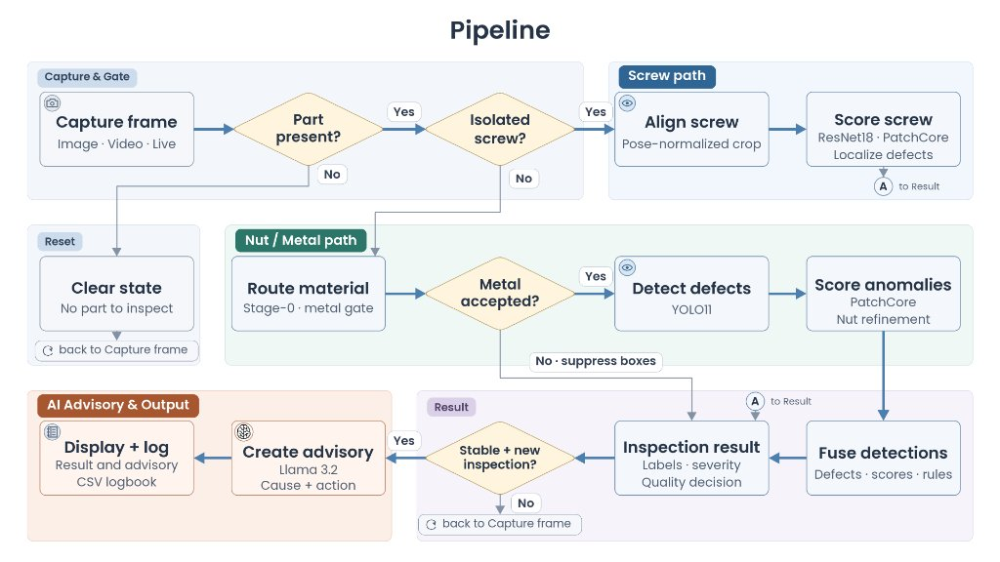

# Offline Metal Surface Inspection and Local Advisory System

Bharat AI-SoC Challenge 2026-27 — Problem Statement 5  
Team: Pritish Mondal, Ritendu Sarkar, and Ritarup Tripathy  
Repository: https://github.com/Ritarup/edge-metal-qc-assistant  
LLM Weights: https://huggingface.co/ritarup/Llama-3.2-1B-UnifiedQC-FT-INT4

An offline C++17 surface inspection and shop-floor advisory system built for Raspberry Pi 5 (8 GB) with a Hailo-8L M.2 AI HAT (13 TOPS). It combines material routing, YOLO11n defect detection, PatchCore reference-based anomaly scoring, a dedicated screw alignment path, a local ExecuTorch Llama 3.2 1B INT4 advisory daemon, a browser SCADA interface on port 5000, and CSV inspection logging.

## Inspection Pipeline



Stage-0 routes frames across 6 classes (`steel_sheet`, `aluminium`, `weld`, `casting`, `machined_part`, `not_metal`). Detected defects are normalized by `config/edge_qc_config.json` into 8 unified groups (`scratch`, `pit_void`, `crack`, `stain_oxide`, `inclusion_slag`, `weld_porosity`, `deformation`, `machining_tear`), assigned severity (`NONE`, `MINOR`, `MODERATE`, `CRITICAL`) and verdict (`PASS`, `REVIEW`, `REJECT`), and queued asynchronously to the resident Llama daemon after 4 centered frames in DEMO mode (or 4 consecutive matching frames on video/camera streams).

CPU affinity (`include/cpu_affinity.hpp`) pins Core 0 to the HTTP server and lifecycle control, Core 1 to vision and PatchCore inference, and Cores 2-3 to the resident Llama daemon (config cap `llm.cpu_threads=4` is clamped at runtime in `src/llama_resident.cpp` to 2 worker threads on 4-core Raspberry Pi 5 hosts).

## Hardware and Environment

| Item | Configuration |
| :--- | :--- |
| Compute board | Raspberry Pi 5 (8 GB RAM, Broadcom BCM2712 quad-core Cortex-A76 @ 2.4 GHz) |
| NPU accelerator | Hailo-8L 13 TOPS M.2 AI HAT (`/dev/hailo0` via `libhailort`) |
| OS and storage | Ubuntu Desktop 24.04.5 LTS (64-bit, `aarch64`) on SanDisk 64 GB microSD card |
| Compiler toolchain | `g++` C++17 with `-O3 -fopenmp -march=armv8.2-a+fp16 -mtune=cortex-a76 -D__ARM_NEON` |
| Input resolution | `640x640` conveyor demo stream (18 FPS); `1280x720 @ 30 FPS` V4L2 camera (`/dev/video0`); static images up to `2048x1000` |
| Web interface | Built-in `cpp-httplib` SCADA UI on port `5000` |

## Models and Weights

| Component | File | Specification |
| :--- | :--- | :--- |
| Stage-0 Material Router | `models/stage0_selector_224.onnx` | YOLO11n-cls `224x224`, 6 classes (5.90 MiB) |
| Stage-1 Defect Detector | `models/unified_yolo11_640.hef` | YOLO11n `640x640` INT8, 8 defect groups, Hailo DFC 3.34.0 (10.53 MiB) |
| Screw Feature Extractor | `models/screw_patchcore_feat.onnx` | ResNet-18 `layer2+3`, `288x288` input (10.68 MiB) |
| Family PatchCore Banks | `models/patchcore_banks/*.bin` | 768 x 28-D coreset per family (steel_sheet, aluminium, weld, casting, machined_part) |
| Screw PatchCore Bank | `models/patchcore_banks/screw.bin` | `1,280 x 384-D` coreset descriptors (1.88 MiB) |
| Llama Tokenizer | `models/tokenizer.model` | SentencePiece tokenizer (2.08 MiB) |
| ExecuTorch Runner Binary | `bin/llama_daemon`, `bin/libllama_runner.so` | ARM64 persistent pipe daemon |
| Advisory LLM Weights | `models/Llama-3.2-1B-UnifiedQC-FT-INT4.pte` | ExecuTorch XNNPACK 8da4w INT4, `group_size=32`, `seq_len=256` (820.09 MiB, hosted externally) |

Because the `.pte` weights exceed GitHub's file size limit, download `Llama-3.2-1B-UnifiedQC-FT-INT4.pte` from https://huggingface.co/ritarup/Llama-3.2-1B-UnifiedQC-FT-INT4 and save it to `models/Llama-3.2-1B-UnifiedQC-FT-INT4.pte` (or `$HOME/.cache/llama_cache/`) before running.

Base LLM: https://huggingface.co/meta-llama/Llama-3.2-1B-Instruct (fine-tuned via https://huggingface.co/unsloth/Llama-3.2-1B-Instruct).

## Repository Layout

```text
.
├── bin/                        # Prebuilt ARM64 llama_daemon and libllama_runner.so
├── config/edge_qc_config.json  # Group thresholds, label aliases, Stage-0, YOLO11, PatchCore, and LLM config
├── docs/                       # Pipeline architecture diagram (pipeline.jpg)
├── include/                    # C++17 headers (vision engine, PatchCore, NEON gate, affinity, IPC, rules)
├── models/                     # ONNX/HEF models, tokenizer.model, and PatchCore .bin coreset banks
├── sample_test_images/         # 26 bundled evaluation and test samples across all material families
├── sample_videos/              # Bundled conveyor_demo_belt.mp4 (525 frames, 18 FPS) and metal_qc_demo_reel.mp4
├── scripts/                    # Launch script and ExecuTorch ARM64 builder
├── src/                        # C++17 implementation and embedded HTML UI fallback
├── templates/index.html        # SCADA web UI served on port 5000
├── third_party/                # cpp-httplib, nlohmann/json, and ONNX Runtime 1.20.1 aarch64 libs/headers
├── Makefile                    # Native C++17 build with automatic HailoRT header detection
└── setup_and_run_rpi5.sh       # Raspberry Pi 5 setup, dependency install, build, and launch script
```

## Build and Run

### Step 1: Clone Repository and Download LLM Weights

```bash
git clone https://github.com/Ritarup/edge-metal-qc-assistant.git
cd edge-metal-qc-assistant

# Download Llama-3.2-1B-UnifiedQC-FT-INT4.pte from:
# https://huggingface.co/ritarup/Llama-3.2-1B-UnifiedQC-FT-INT4
# Place the file at models/Llama-3.2-1B-UnifiedQC-FT-INT4.pte
```

### Step 2: Build and Launch

Choose **one** of the two options below (do not run both):

#### Option A: Automated Setup and Launch (Recommended for Raspberry Pi 5)

```bash
bash setup_and_run_rpi5.sh
```

`setup_and_run_rpi5.sh` installs system build dependencies (`build-essential`, `libopencv-dev`, `v4l-utils`), restores ONNX Runtime ARM64 shared-library symlinks, checks `/dev/hailo0` and `libhailort`, verifies model assets and `bin/llama_daemon`, builds `bin/bharat_qc_native.bin`, and launches the SCADA node on port 5000.

#### Option B: Manual Build and Launch (if dependencies are already installed)

```bash
# Build native C++17 binary (links libhailort automatically when /usr/include/hailort is present)
make -j"$(nproc)"

# Start the engine with runtime LD_LIBRARY_PATH configuration
bash scripts/run_native.sh
```

### Optional: Rebuild the ExecuTorch Daemon from Source

Prebuilt ARM64 binaries (`bin/llama_daemon` and `bin/libllama_runner.so`) are already included, so you do not need to run this unless you want to recompile ExecuTorch from source:

```bash
bash scripts/build_llama_arm64.sh
```

## Web Interface and HTTP API

Once running, open `http://localhost:5000` (or `http://<device-ip>:5000`).  
The interface provides five operating modes (`DEMO`, `IMAGE`, `VIDEO`, `CAMERA`, `LOG`), clean reference registration (`Register Good`), and inspection export (`rpi5_qc_inspection_log.csv`).  
Keyboard shortcuts: `1`-`5` switch modes, `Space` toggles pause/resume, `P` goes to the previous sample, `N` advances to the next sample, `S` saves a snapshot, `O` opens media upload, and `G` registers the current clean specimen.

| Method and Route | Description |
| :--- | :--- |
| `GET /`, `GET /index.html` | Serves `templates/index.html` (or built-in fallback UI) |
| `GET /api/state`, `GET /api/telemetry` | Current inspection state, boxes, PatchCore score, and LLM advisory |
| `GET /api/bench` | Rolling vision timing breakdown, FPS, RSS memory, and LLM metrics |
| `GET /api/frame.jpg`, `GET /api/stream` | Annotated JPEG stream (supports `?since=<frame_seq>` HTTP 204 skip) |
| `GET /api/switch_mode?mode=...` | Switch mode (`DEMO`, `IMAGE`, `VIDEO`, `CAMERA`, `LOG`) |
| `GET /api/next`, `GET /api/prev`, `GET /api/toggle_pause` | Advance stations/samples or toggle pause |
| `GET /api/select_item`, `GET /api/control` | Select media item or send control commands |
| `POST /api/upload` | Upload image or video file to active playlist |
| `POST /api/register_good` | Add clean reference sample to `models/patchcore_banks/<family>.bin` |
| `GET /api/logs`, `POST /api/clear_logs`, `GET /api/download_csv` | Query, clear, or download `rpi5_qc_inspection_log.csv` |
| `POST /api/save_frame` | Save current annotated frame under `snapshots/` |

## Datasets and Measured Results

Training and evaluation datasets covered NEU-DET (steel surface defects), GC10-DET (wide steel strip defects), MVTec AD (`metal_nut` and `screw` anomalies), plus welding porosity, casting, aluminium, non-metal, and clean steel collections.

| Metric | Result |
| :--- | :--- |
| Part inspection rate | 13.0 to 15.3 FPS |
| Vision cycle latency (per-image) | 65.4 to 76.9 ms |
| Time to first token (TTFT) | 1,588 to 1,925 ms |
| Advisory generation rate | 13.8 to 15.1 tokens/s |
| Total advisory latency | 4,162 to 5,963 ms |
| End-to-end latency (frame to advisory) | 4,236 to 6,038 ms (vision cycle + Llama advisory on locked part) |
| Material routing accuracy | 97.3% Val Top-1 (100.0% Top-5 on 875 images); 100.0% (26/26) on bundled E2E suite |
| Defect precision, recall and F1 | 77.5% precision / 73.0% recall / 75.2% F1 (0.75) (Unified YOLO11n-640 Val, 827 images / 1,455 instances) |
| Detection mAP | 50.9% mAP@50-95 (80.48% mAP@50 on Unified YOLO11n-640 Val, 827 images / 1,455 instances) |
| Anomaly detection AUROC | 0.9905 Image / 0.9778 Pixel AUROC (MVTec `metal_nut`, 93.83% acc); 0.8200 Image AUROC / 93.3% GT hit (MVTec `screw`) |
| Completed inspection throughput | 4.4 to 4.7 parts/min (14-15 stations logged in ~190 s with Llama advisory + 4 s hold) |
| Peak resident memory | 203.92-351.5 MiB (`bharat_qc_native.bin`) + ~889 MiB (`llama_daemon`) ≈ 1.07-1.21 GiB (<16% of 8 GB RAM) |
